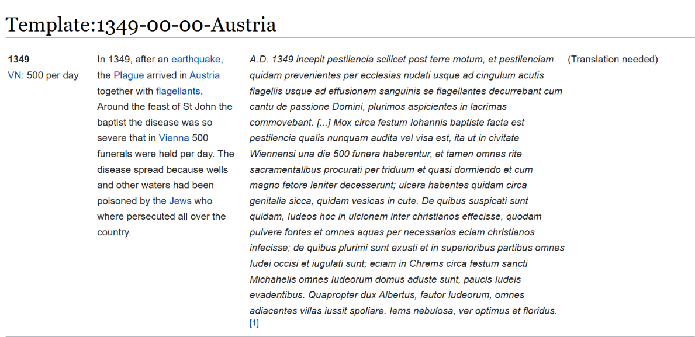
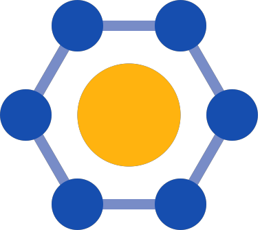
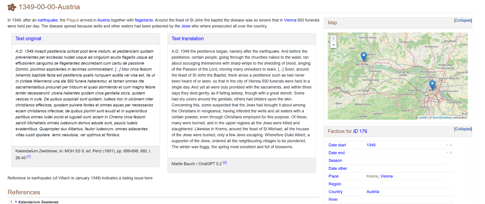

## What is EpiMedDat? {.slide-compact}

**[EpiMedDat](https://epimeddat.net)** is the Open **Data** Collection for Historical **Epidemics** and **Medieval** Diseases

<div class="columns">
<div class="column">
**About**

* Started 2020 by GWZO
* Developing a collaborative, open, scientific database
* Collecting historical data on epidemic diseases in the Middle Ages
* Built on (plain) MediaWiki

</div>
<div class="column">
{height="400px"}
</div>
</div>

## Bringing historical epidemic diseases in structured shape {.slide-compact .slide-code-img}

<div class="columns">
<div class="column">

```
{{Tab5C
|TTemp   = Template:1349-00-00-Austria 
|SYear   = 1349 
|SMonth  =  
|SDay    =  
|EYear   =  
|EMonth  =  
|EDay    =  
|Summary = In 1349, after an [[earthquake]], the [[Plague]] arrived in [[Austria]] together with [....]. 
|Source  = A.D. 1349 incepit pestilencia scilicet post terre motum, [...] 
|Transl  =  
|TRef    = {{TN}} 
|ERef    = <ref>Kalendarium Zwetlense, in: M[...]</ref> 
|VN      = 500 per day
}}
```

</div>
<div class="column">

{width="100%"}

</div>
</div>

## Templates are still software! 

<div class="swatches ">
<div class="swatch swatch-blue small"><strong>Overview-Pages (Places, Keywords)</strong>

* Every page had its own `{{Template}}`, containg the data templates (hand curated!)
* Content has not to be stored redundant
* But many, many templates has to be touched. 
* Nice for collecting and displaying data - but not queryable.

</div>
<div class="swatch small">
<strong>Krems (City in Austria)</strong>
```
{{Template:Top Cat Nav}}
{{First}} It is a large city in [[Austria]].

== Events ==
{{Tab top}}
{{Template:Krems}}

== References ==
<references />

{{Places Austria nav}}
{{PC}}{{EMD}}{{YT}}

[[Category:Krems]]
[[Category:Places]]
```

```markdown
{{Krems
  {{Template:1349-00-00-Austria}}
  {{Template:1349-00-00-Austria-01}}
}}  
```
</div>
</div>

## Let's semantify this Wiki! {data-background="#c00000" class="kma-chapter"}

* Semantic Media Wiki? 
* Wikibase? 
* ➡️ What fits best?

## Semantic MediaWiki or Wikibase? {.slide-compact}

:::: {.kma-grid .two-col}
::: {.kma-card}
**SMW** {.logo-inline}

**Pro**

* Existing Template Structure 
* Dedicated request from researchers
* Entities are only `strings`

**Cons**

* Thinking about SPARQLing in federated way 🤩
:::

::: {.kma-card}
**Wikibase** {.logo-inline}

**Pro**

* No large text fragments
* Thinking about SPARQLing in federated way 🤩

**Cons**

* Entities aren't linked to anything else (`strings`)
:::
::::

## How did we decided?  {data-background="#0070c0" class="kma-chapter"}

<p class="fragment">Let's do both!</p>

{height="150px" .fragment .fade-up} {height="150px" .fragment .fade-up}

## Migration {.slide-compact}

<div class="swatches ">
<div class="swatch swatch-red "><strong>Analyze Existing Data</strong>

* Get a full dump
* Separate Disease data from Entity-Pages
* Analyse Categories for missing Entity-Pages and attributive values

</div>
<div class="swatch swatch-blue "><strong>Prepare and Refine</strong>

* Define Properties and SMW-Templates
* Refine Entities with OpenRefine (FactGrid)
* Create `date` values
* Fetch `coordinates` for place names

</div>
<div class="swatch swatch-text "><strong>Writing the new Wiki</strong>

* Writing the data using `MWAPI` and a `python`-scriptset.
* Uploading to FactGrid (dedicated Wikibase for historians)
* Building Entity-Pages with `ASK`-queries

</div>
</div>

# Semantic EpiMedDat (since 2026-01)

## New EpiMedDat Wikistyle 



## Compare Wikitext
<div class="columns">
<div class="column">
**Template-Style**
```
{{Tab5C
|TTemp   = Template:1349-00-00-Austria 
|SYear   = 1349 
|SMonth  =  
|SDay    =  
|EYear   =  
|EMonth  =  
|EDay    =  
|Summary = In 1349, after an [[earthquake]], the [[Plague]] arrived in [[Austria]] together with [....]. 
|Source  = A.D. 1349 incepit pestilencia scilicet post terre motum, [...] 
|Transl  =  
|TRef    = {{TN}} 
|ERef    = <ref>Kalendarium Zwetlense, in: M[...]</ref> 
|VN      = 500 per day
}}
```

</div>
<div class="column">
**Semantic MediaWiki Style** {.logo-inline}
```
{{Disease
|Date start=1349
|Place=Krems; Vienna
|Country=Austria
|Natural event=Earthquake
|Victim=500
|Victim count type=per day
|Disease=Plague
|Epidemic wave=Black Death
|Keyword=Flagellants; Jews; Pogrom; Water poisoning
|Reference=Kalendarium Zwetlense, in:  [...] 
|Summary=In 1349, after an [[earthquake]], the [[Plague]] arrived in [[Austria]] [...] 
|Translation=A.D. 1349 the pestilence began,  [...] 
|Language=Latin
|FactGridID=Q1871822
}}
```

</div>
</div>

## Compare Page View {.slide-compact}

<div class="img-rows">

{height="270px"}
{height="270px"}

</div>

## Additional ingest and linking to Wikibase {.slide-compact}

:::: {.kma-grid}
::: {.kma-card}
**FactGrid**

* OpenRefine was already used for data prepartion
* FactGrid provides much more string based properties 
* Create Identifier to EpiMedDat (`FactGrid-Prop:P1470`)
:::
::: {.kma-card}
**Wikidata**

* Additionally reconciled to Wikidata
* Wikidata → FactGrid Migration tool 
* Set `unknown value` with Wikidata-ID in FactGrid
:::
::: {.kma-card}
**EpiMedDat**

* `Property:FactGrid` set on all disease-pages and all entity pages
* `Property:Wikidata ID` set on all conceptual entity pages

:::
::::

## SPARQL-Power


##  Links
* [EpiMedDat.net](https://epimeddat.net)
* [Old Data Dump](https://zenodo.org/records/18715840) {.logo-inline}
* [FactGrid (Wikibase) - List of all entries](https://database.factgrid.de/query/index.html#%23title%3AList%20of%20all%20EpiMedDat%20Disease-Entries%20in%20FactGrid%0ASELECT%20%3Fitem%20%3FitemLabel%20%3FitemDescription%20%3FepimMedDatId%20WHERE%20%7B%0A%3Fitem%20wdt%3AP1470%20%3FepimMedDatId%3B%20wdt%3AP2%20wd%3AQ9.%20%0A%20%20SERVICE%20wikibase%3Alabel%20%7B%20bd%3AserviceParam%20wikibase%3Alanguage%20%22%5BAUTO_LANGUAGE%5D%2Cen%22.%20%7D%0A%7D)